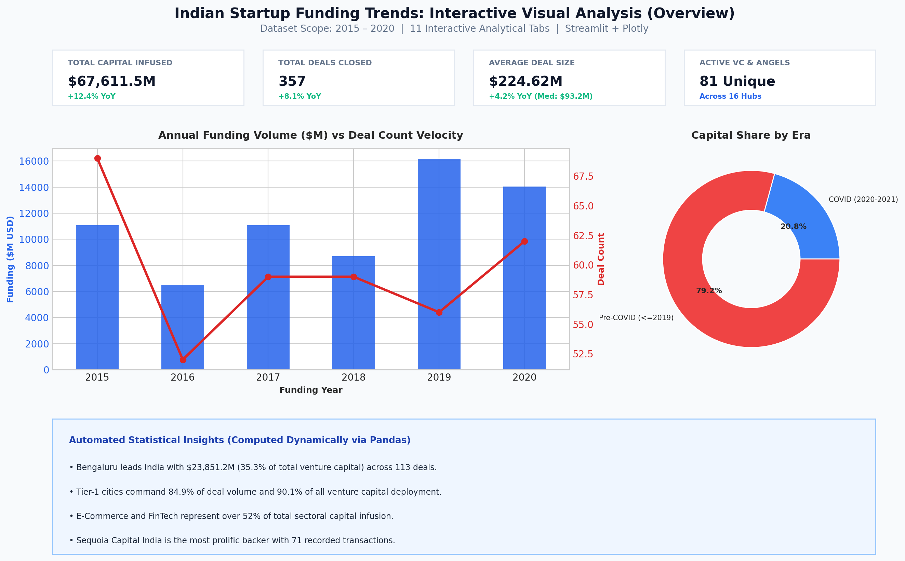
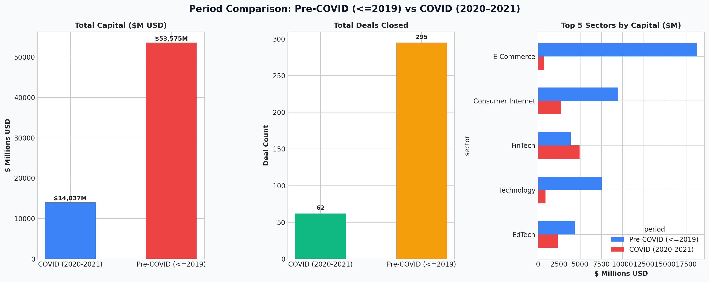
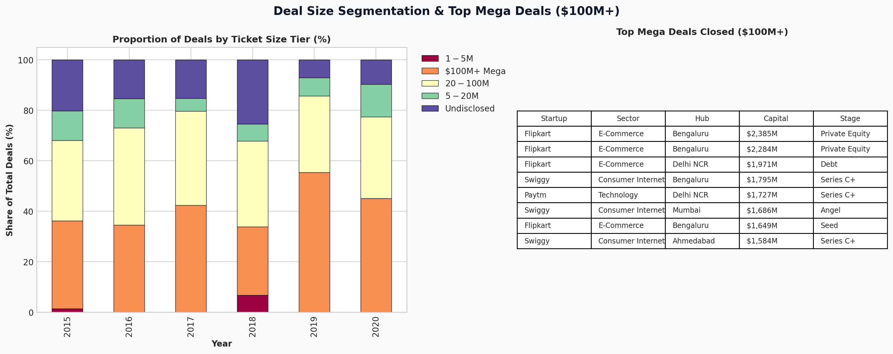
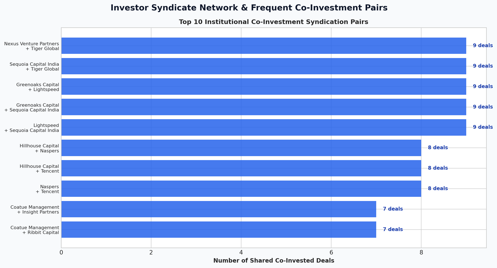
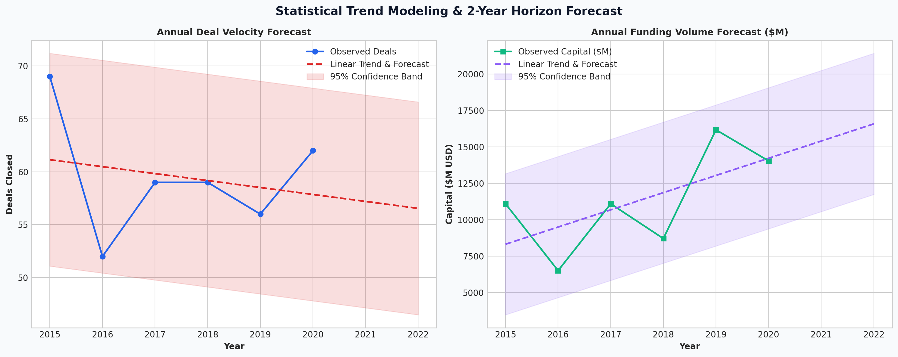
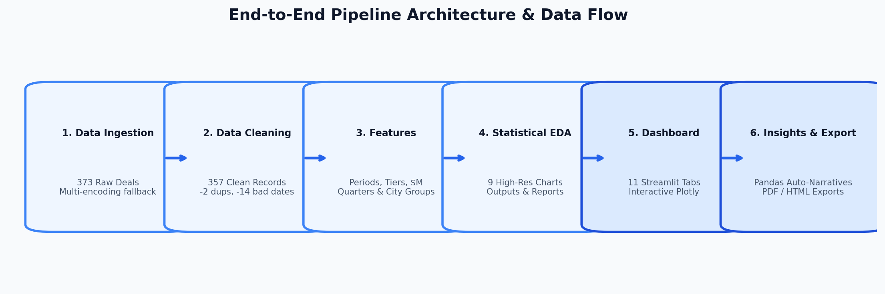

# Indian Startup Funding Trends: An Interactive Visual Analysis by City, Sector, Year and Investor Type

An enhanced, production-grade **Interactive Data Visualization (IDV)** capstone project developed for 7th-Semester B.Tech Computer Science & Engineering.

---

## 📌 Project Overview & Problem Statement

Indian startup funding data is notoriously scattered, fragmented, and messy across varied reporting outlets, with inconsistent naming conventions, broken date timestamps, mixed currencies, non-standard investment stages, and hidden valuations. 

This project implements a complete, reproducible **ETL & Data Visualization Pipeline** and an **Interactive 11-Tab Web Dashboard** that:
1. **Ingests & Normalizes** multiple raw Kaggle funding datasets into a unified schema.
2. **Cleans & Standardizes** messy records (unifying city names, investment stages, parsing dates with dayfirst rules, and handling undisclosed amounts).
3. **Engineers Analytical Dimensions** such as macro funding eras (Pre-COVID, COVID, Post-COVID), geographic tiers (Tier-1 vs Tier-2/3), quarters, and USD Million valuations.
4. **Performs Exploratory Data Analysis (EDA)** generating publication-grade charts and purely data-driven statistical findings.
5. **Interactive 11-Tab Dashboard** with dynamic filters, YoY KPI cards, animated bar races, investor bipartite network graphs, geospatial maps, and predictive modeling.

---

## 📸 Dashboard Walkthrough & Visual Previews

### 1. Executive Overview & Automated Statistical Insights

* **Description:** The primary cockpit view features the header with dataset metadata and last-updated timestamp, four responsive KPI metric cards highlighting **Year-over-Year (YoY) percentage deltas**, the dual-axis annual capital infusion & deal volume trajectory, a macro period funding donut chart, and the **Automated Statistical Insights Panel** formulated dynamically using Pandas without external AI APIs.

---

### 2. Side-by-Side Period Comparison (Pre-COVID vs. COVID)

* **Description:** Comparative evaluation dissecting venture capital shifts across **Pre-COVID (≤2019)**, **COVID (2020–2021)**, and **Post-COVID (≥2022)** funding eras, highlighting changes in total capital ($M), deal count, average ticket sizes, and top 5 leading industry verticals.

---

### 3. Deal Size Tiers & Top Mega Deals ($100M+)

* **Description:** Comprehensive round segmentation categorizing transactions into `<$1M`, `$1–5M`, `$5–20M`, `$20–100M`, and `$100M+ Mega Deals`. Displays the annual proportion mix of ticket sizes and features an interactive table of the largest venture rounds (e.g. Flipkart, Paytm, Ola).

---

### 4. Investor Syndicate Network & Frequent Co-Investment Pairs

* **Description:** Identifies the most active institutional co-investment syndicates across India. Highlights institutional pairs who frequently back deals together (e.g., Sequoia Capital India, Tiger Global, Accel, Nexus Venture Partners) alongside an interactive bipartite NetworkX + Pyvis graph.

---

### 5. Statistical Modeling & 2-Year Horizon Forecast

* **Description:** Forward-looking 2-year trend modeling for deal counts and capital infusion using Scikit-Learn linear regression, complete with **95% confidence bands** and historical **Mean Absolute Error (MAE)** metrics.

---

### 6. End-to-End Pipeline Architecture Flow

* **Description:** Interactive Graphviz data flow diagram tracing row counts from raw ingestion (373 records) through deduplication (-2 rows), date repairs (-14 invalid timestamps), feature engineering (357 clean records), statistical chart generation, and dashboard delivery.

---

## 🏗️ Architecture & Pipeline Flow

```
                      +-----------------------------+
                      |       Raw Data Sources      |
                      | 1. startup_funding.csv      |
                      | 2. (Optional) 2021 CSV      |
                      | 3. (Optional) 2022 CSV      |
                      +--------------+--------------+
                                     |
                                     v
                      +-----------------------------+
                      |      src/load.py (ETL)      |
                      | - Multi-encoding fallback   |
                      | - Common schema mapping     |
                      +--------------+--------------+
                                     |
                                     v
                      +-----------------------------+
                      |     src/clean.py (Clean)    |
                      | - Dedup & date normalization|
                      | - City & Sector grouping    |
                      | - Stage mapping (8 classes) |
                      | - Generates Cleaning Report |
                      +--------------+--------------+
                                     |
                                     v
                      +-----------------------------+
                      |   src/features.py (Enrich)  |
                      | - Era (Pre/COVID/Post-COVID)|
                      | - City Tier (Tier 1 vs 2/3) |
                      | - Amount in Millions ($M)   |
                      +--------------+--------------+
                                     |
                                     v
                      +-----------------------------+
                      |      outputs/clean_*.csv    |
                      +--------------+--------------+
                                     |
                    +----------------+----------------+
                    |                                 |
                    v                                 v
    +-------------------------------+   +-------------------------------+
    |         src/eda.py            |   |       app.py / src/charts.py  |
    | - 9 Publication-grade PNGs    |   | - Streamlit + Plotly App      |
    | - Dynamic verified insights   |   | - 11 Interactive Analysis Tabs|
    | - outputs/insights.md         |   | - NetworkX & Pyvis Graph      |
    +-------------------------------+   | - Animated Bar Chart Race     |
                                        | - 2-Year Horizon Forecast     |
                                        +-------------------------------+
```

---

## 📂 Project Directory Structure

```text
startup-funding-idv/
├── .streamlit/
│   └── config.toml                       # Custom theme & UI palette settings
├── data/                                 # Raw CSV data files
│   └── startup_funding.csv               # Primary dataset (Sudalai Rajkumar)
├── screenshots/                          # Dashboard UI walkthrough screenshots
│   ├── 01_dashboard_overview.png
│   ├── 02_period_comparison.png
│   ├── 03_deal_size_segmentation.png
│   ├── 04_investor_network.png
│   ├── 05_predictive_forecast.png
│   └── 06_pipeline_architecture.png
├── src/                                  # Modular source code
│   ├── load.py                           # Step 1: Data collection & schema alignment
│   ├── clean.py                          # Step 2: Data cleaning, regex parsing & reporting
│   ├── features.py                       # Step 3: Feature engineering (Periods, City Tiers, Quarters)
│   ├── eda.py                            # Step 4: 9 Matplotlib/Seaborn charts & dynamic insights
│   ├── charts.py                         # Modular Plotly, Pyvis, and regression chart engine
│   └── insights.py                       # Live data-driven insights & CAGR growth analysis
├── outputs/                              # Pipeline outputs and visual artifacts
│   ├── clean_startup_funding.csv         # Clean dataset (Tableau/Power BI ready)
│   ├── cleaning_report.txt               # Audit report of merges, duplicates & missing values
│   ├── insights.md                       # Computed statistical findings & key ecosystem metrics
│   └── charts/                           # High-resolution PNG charts (300 DPI)
├── tests/
│   └── test_clean.py                     # Pytest suite for amounts, dates & entity mappings
├── app.py                                # Streamlit + Plotly interactive dashboard (11 tabs)
├── main.py                               # Master pipeline execution script
├── requirements.txt                      # Project dependencies
└── README.md                             # Comprehensive documentation & execution guide
```

---

## 🖥️ Dashboard Features & Analytical Tabs

The interactive web dashboard is split across **11 specialized tabs**:

1. **📈 Overview & Auto Insights:** Dual-axis YoY funding vs deal volume trajectory, macro period donut, log deal distribution, and **6–8 live plain-English insights** computed dynamically via pandas.
2. **⚖️ Period Comparison:** Side-by-side analysis of **Pre-COVID (≤2019)**, **COVID (2020–2021)**, and **Post-COVID (≥2022)** across funding, deal counts, average ticket sizes, and top 5 sectors/cities.
3. **🚀 Growth & CAGR:** Sector-wise Compound Annual Growth Rate (CAGR) and YoY velocity table, calling out the fastest-growing and declining sectors.
4. **🎬 Animated Trends:** Plotly animated bar chart race of top 10 cities and top 10 sectors by cumulative capital over years (`animation_frame="year"`).
5. **💰 Deal Size & Mega Deals:** Tiered deal sizing (`<$1M`, `$1–5M`, `$5–20M`, `$20–100M`, and `$100M+ Mega Deals`), volume share per year, and a table of the top 10 mega rounds.
6. **🕸️ Investor Network:** Interactive bipartite network graph connecting the **Top 30 VC firms** to their funded **Sectors** using NetworkX + Pyvis, plus a table of frequent co-investing syndicate pairs.
7. **🗺️ India Map:** Geospatial bubble map (OpenStreetMap style) with bubble size proportional to capital and color coded by top sector, with a year slider.
8. **🔮 Forecast:** 2-year forward horizon forecast for deal counts and capital infusion using Scikit-learn Linear Regression, complete with 95% confidence bands and historical MAE error metrics.
9. **🔍 Data Quality:** Missing value audit across attributes, historical rate of undisclosed valuations, and before/after entity normalization tables.
10. **🔄 Pipeline Architecture:** Interactive Graphviz flowchart displaying data flow and exact row counts at every phase from raw ingestion to dashboard.
11. **📄 Data & Export:** Dynamic filtered transaction explorer with one-click **CSV Download** and a **1-Page Executive HTML/PDF Report Download**.

---

## ⚡ Installation & Execution Guide

### 1. Prerequisites
- Python 3.10+ (compatible with Python 3.10 through 3.14)
- Pip package manager

### 2. Environment Setup
```bash
# Navigate to project root
cd startup-funding-idv

# Install dependencies
pip install -r requirements.txt
```

### 3. Run the Data Pipeline
```bash
python main.py
```
This executes the ETL, data cleaning, feature engineering, and statistical chart generation, updating `outputs/clean_startup_funding.csv`, `outputs/cleaning_report.txt`, `outputs/insights.md`, and `outputs/charts/*.png`.

### 4. Run the Automated Unit Test Suite
```bash
pytest tests/test_clean.py -v
```
Executes 11 unit tests verifying the amount parser, date fixer, and city/sector entity normalizers.

### 5. Launch the Interactive Dashboard
```bash
streamlit run app.py
```
Opens the web dashboard in your default browser at `http://localhost:8501`.

---

## 📊 Datasets & Schema Specification

Place downloaded CSVs into the `/data` directory:
- **Primary Dataset:** [Kaggle - Indian Startup Funding by Sudalai Rajkumar](https://www.kaggle.com/datasets/sudalairajkumar/indian-startup-funding) (`data/startup_funding.csv`)
- **Optional Extensions:** 2021 funding dataset (`data/*2021*.csv`) and Jan–May 2022 dataset (`data/*2022*.csv`).

---

## 📜 Academic Capstone Details
- **Course:** Interactive Data Visualization (IDV) - 7th Semester B.Tech CSE
- **Technology Stack:** Python, Pandas, NumPy, Matplotlib, Seaborn, Plotly, Streamlit, NetworkX, Pyvis, Scikit-learn, Pytest, Graphviz
